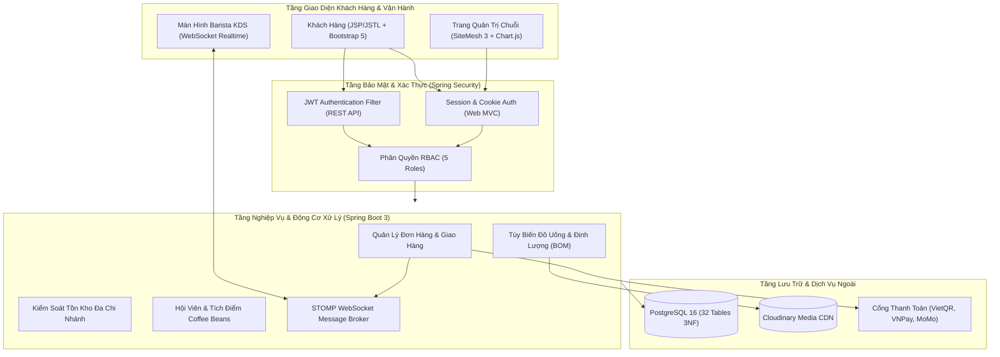
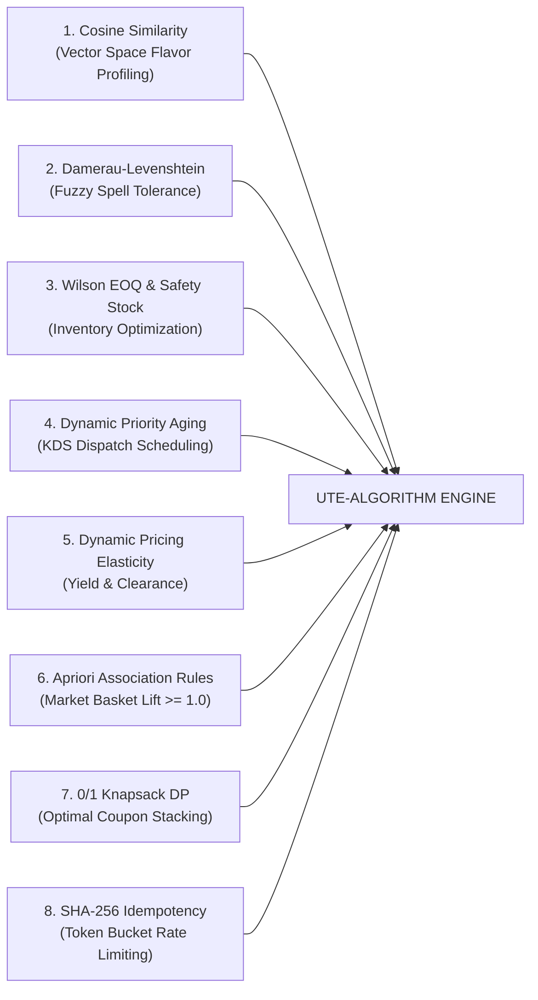
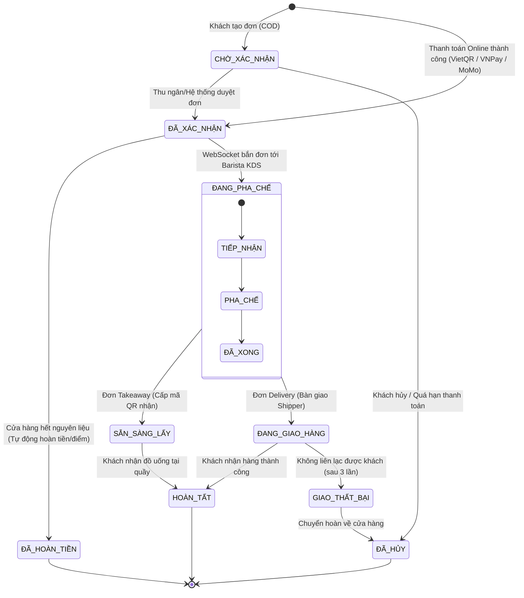
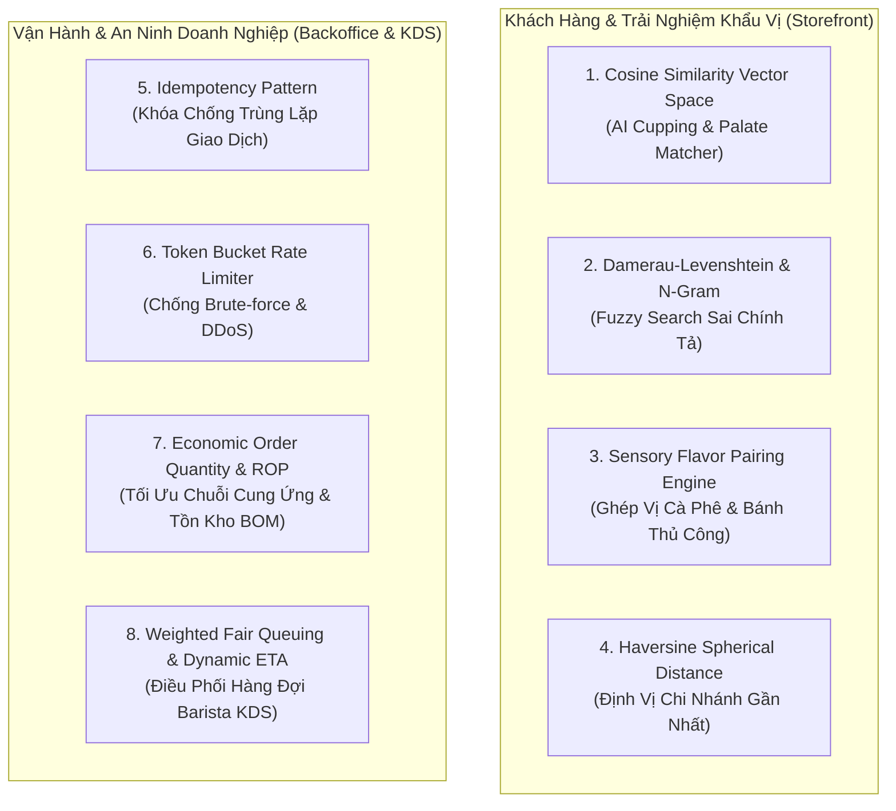

<p align="center">
  <picture>
    <source media="(prefers-color-scheme: dark)" srcset="03_Thiet_Ke_Thuong_Hieu_Logo/logo_chinh_ngang_dark.svg">
    <source media="(prefers-color-scheme: light)" srcset="03_Thiet_Ke_Thuong_Hieu_Logo/logo_chinh_ngang_light.svg">
    
  </picture>
</p>

<p align="center">
  <strong>Hệ Thống Website Thương Mại Điện Tử Chuỗi Bán Trà & Cà Phê Đặc Sản UTECoffe</strong><br>
  <em>Nền tảng thương mại đa kênh OMO (Online-Merge-Offline) • Quầy Barista thời gian thực KDS • Quản trị chuỗi cửa hàng F&B</em>
</p>

<p align="center">
  <a href="https://utecoffe.io.vn"></a>
  <a href="#-công-nghệ-sử-dụng"></a>
  <a href="#-công-nghệ-sử-dụng"></a>
  <a href="#-công-nghệ-sử-dụng"></a>
  <a href="#-công-nghệ-sử-dụng"></a>
  <a href="#-công-nghệ-sử-dụng"></a>
  <a href="#-công-nghệ-sử-dụng"></a>
</p>

<p align="center">
  <a href="#-tên-miền-chính-thức-utecoffe-iovn">🌐 Tên Miền</a> •
  <a href="#-giới-thiệu-đề-tài">Giới Thiệu</a> •
  <a href="#-nghiệp-vụ-cốt-lõi">Nghiệp Vụ F&B</a> •
  <a href="#-kiến-trúc-hệ-thống">Kiến Trúc</a> •
  <a href="#-cơ-sở-dữ-liệu">CSDL 34 Bảng</a> •
  <a href="#-tài-liệu-báo-cáo-word">Hồ Sơ Báo Cáo</a> •
  <a href="#-hướng-dẫn-cài-đặt">Cài Đặt</a> •
  <a href="#-tác-giả--bản-quyền">Tác Giả</a>
</p>

---

## 🌐 Tên Miền Chính Thức: utecoffe.io.vn

Hệ thống đã được thiết lập sẵn sàng để chạy trực tiếp trên tên miền chính thức **[https://utecoffe.io.vn](https://utecoffe.io.vn)**:
- **DNS Records:** A Record `@` trỏ về IP máy chủ VPS, CNAME `www` trỏ về `utecoffe.io.vn`.
- **Nginx Reverse Proxy & SSL:** Đã tích hợp cấu hình mẫu tại [`deployment/nginx/utecoffe.io.vn.conf`](deployment/nginx/utecoffe.io.vn.conf) hỗ trợ tự động chuyển hướng HTTPS, HTTP/2, WebSocket STOMP (`/ws-utecoffe`), và nén Gzip.
- **SEO & Meta Tags:** Thẻ Canonical, OpenGraph, Twitter Card, `robots.txt` và `sitemap.xml` đã được cấu hình trỏ chuẩn xác về domain chính thức `https://utecoffe.io.vn`.
- **CORS & Cookies:** Đã cấp quyền CORS và cấu hình Session Cookie phân giải an toàn trên domain `utecoffe.io.vn`.
- **Tài liệu hướng dẫn triển khai:** Xem chi tiết tại [`deployment/DOMAIN_SETUP_GUIDE.md`](deployment/DOMAIN_SETUP_GUIDE.md).

---

---

## 📌 Giới Thiệu Đề Tài

**UTECOFFE** là đồ án xây dựng hệ thống website thương mại điện tử chuyên biệt phục vụ chuỗi cửa hàng bán lẻ trà và cà phê đặc sản, tích hợp mô hình OMO (*Online-Merge-Offline / Bán hàng đa kênh*). Dự án giải quyết trọn vẹn bài toán vận hành thực tế ngành dịch vụ ăn uống (F&B):
- **Đối với Khách hàng:** Đặt món giao tận nơi (*Delivery*) hoặc lấy tại quán (*Takeaway Pickup*), tùy biến kích cỡ/đường/đá/topping, đặt bàn trước trực tuyến, thanh toán đa kênh (VietQR, VNPay, MoMo, COD) và tích lũy điểm hội viên.
- **Đối với Quầy pha chế (Barista):** Màn hình KDS (*Kitchen Display System*) nhận đơn thời gian thực qua WebSocket STOMP, cập nhật tiến độ pha chế 1-chạm phản hồi tức thì về ứng dụng của khách hàng.
- **Đối với Quản lý & Ban điều hành:** Quản lý tồn kho theo từng chi nhánh, định lượng công thức nguyên liệu (BOM), báo cáo doanh thu trực quan bằng Chart.js và phân quyền dữ liệu nghiêm ngặt theo 5 vai trò.

- **Đơn vị đào tạo:** Trường Đại học Sư phạm Kỹ thuật TP.HCM (HCMUTE)
- **Học phần:** Đồ án Lập trình Web / Hệ thống Thương mại Điện tử

---

## 🏛 Kiến Trúc Hệ Thống (Architecture Flow)



---

## 🎯 14 Khối Nghiệp Vụ F&B Doanh Nghiệp & Chuỗi Cửa Hàng

| Khối Nghiệp Vụ | Mô Tả Chức Năng Chi Tiết |
| :--- | :--- |
| **1. Tùy Biến Đồ Uống (BOM Recipe)** | Hỗ trợ Size S/M/L, chọn % đường (0%, 30%, 50%, 70%, 100%, đường ăn kiêng), chọn mức đá (Nóng, 0%, 30%, 50%, 70%, 100%, Đá riêng), topping đa dạng (Trân châu, kem cheese, pudding). Với cà phê hạt: chọn mức độ rang (Light/Medium/Dark) và cỡ xay (Nguyên hạt, pha phin, pha máy Espresso, Cold Brew). Gợi ý bánh ngọt ăn kèm (Cross-sell). |
| **2. Bán Hàng Đa Kênh (Omnichannel)** | **Giao tận nơi (Delivery):** Tự động xác định chi nhánh gần nhất theo tọa độ địa lý (Haversine), tính phí vận chuyển theo khoảng cách thực tế (km).<br>**Lấy tại quán (Takeaway Pickup):** Khách chọn chi nhánh, đặt giờ hẹn nhận món và nhận mã QR nhận hàng tại quầy. |
| **3. Tồn Kho Đa Chi Nhánh (Store Stock)** | Kiểm soát tồn kho nguyên liệu độc lập tại từng cơ sở. Tự động chuyển trạng thái "Tạm hết món" tại chi nhánh thiếu nguyên liệu mà không làm ảnh hưởng tới việc kinh doanh của các chi nhánh khác. |
| **4. Quầy Pha Chế KDS Thời Gian Thực** | Đẩy đơn hàng mới tức thì qua WebSocket STOMP kèm âm thanh chuông báo tới màn hình Barista của chi nhánh. Xếp hàng pha chế theo cơ chế FIFO (First-In, First-Out), cảnh báo đổi màu theo thời gian chờ. Barista đổi trạng thái 1-chạm (*Tiếp nhận -> Đang pha -> Pha xong*). |
| **5. Cập Nhật Tiến Trình Realtime** | Khi Barista hoàn thành pha chế, WebSocket tự động đẩy dữ liệu cập nhật trạng thái đơn hàng trên thanh tiến trình (Tracking Stepper) của khách hàng mà không cần tải lại trang. |
| **6. Hội Viên & Điểm Thưởng (Loyalty)** | Tích lũy điểm thưởng: **10.000 VNĐ = 1 Coffee Bean (hoặc 10% giá trị đơn)**. Tự động xếp 4 hạng: **Đồng (Bronze) -> Bạc (Silver) -> Vàng (Gold - Giảm 10%) -> Kim Cương (Diamond - Giảm 15%)**. Ví voucher cá nhân, đổi điểm lấy mã giảm giá hoặc quà tặng sinh nhật. |
| **7. Khuyến Mãi Đa Tầng (Promotion Engine)** | Mã giảm giá Coupon, khung giờ vàng Happy Hour, mua 1 tặng 1 (BOGO), combo tiết kiệm (Trà + Bánh). Cơ chế kiểm tra điều kiện áp dụng và giới hạn lượt dùng chống lạm dụng mã. |
| **8. Thanh Toán Đa Kênh & Hoàn Tiền** | Tiền mặt khi nhận hàng (COD), VNPay, MoMo, ZaloPay. **VietQR động:** Tạo mã QR chuyển khoản chứa mã đơn và số tiền chính xác, tự động đối soát giao dịch. Tự động hoàn tiền/hoàn điểm khi hủy đơn do sự cố. |
| **9. Đặt Bàn Trực Tuyến (Table Reservation)** | Chọn 3 chi nhánh Flagship, ngày giờ, số lượng khách và khu vực bàn (*Quầy Barista trải nghiệm, Sofa VIP Lounge, Sân Vườn Xanh, Bàn Đôi Lãng Mạn*). |
| **10. Báo Cáo Kinh Doanh & Phân Quyền** | Báo cáo doanh thu theo ngày/tháng/năm, so sánh doanh thu giữa 3 chi nhánh, thống kê Top 10 đồ uống bán chạy nhất qua biểu đồ Chart.js. Phân quyền chặt chẽ 5 vai trò (*Admin, Store Manager, Barista, Shipper, Customer*) và Audit Log ghi vết thao tác AOP. |
| **11. Quản Lý Đánh Giá & CX Khách Hàng (`/admin/reviews`)** | Theo dõi điểm hài lòng trung bình (4.9/5.0 ⭐), tỷ lệ phản hồi 100%, duyệt phản hồi và gửi phản hồi CSKH trực tiếp từ Ban quản trị. |
| **12. Chuỗi Cung Ứng & PO Nhập Kho (`/admin/suppliers`)** | Quản lý đối tác nông trại chiến lược (*Cầu Đất Farm, Mộc Châu Tea, Dalat Milk, Elle & Vire*), theo dõi vòng đời Đơn đặt hàng nhập kho (PO) từ tạo đơn, vận chuyển đến kiểm đếm nhập kho. |
| **13. Chuẩn Hóa Công Thức SOP (`/admin/recipes`)** | Bộ tiêu chuẩn định lượng pha chế: tỷ lệ chiết xuất (1:2 Espresso / 1:10 Cold Brew), nhiệt độ nước (92°C - 94°C), thời gian ủ lạnh (18 - 24 tiếng) bảo đảm chất lượng đồ uống đồng nhất toàn chuỗi. |
| **14. Xử Lý Khiếu Nại & Hoàn Tiền (`/admin/refunds`)** | Theo dõi đối soát đơn lỗi/đổ vỡ, xử lý bồi hoàn 100% vào Ví Điểm Thưởng UTEClub cho thành viên trong vòng 15 phút. |

---

## ⚡ 8 Giải Thuật Toán Học & Khoa Học Máy Tính Doanh Nghiệp (Enterprise Algorithms & Formulations)

Hệ thống UTECoffe tích hợp 8 thuật toán chuyên sâu nhằm giải quyết triệt để các bài toán tối ưu hóa trong vận hành chuỗi F&B cao cấp:



### 1. Thuật Toán Không Gian Vector & Độ Tương Đồng Cosine (Cosine Similarity Flavor Profiling)
- **Bài toán:** Khách hàng có sở thích cảm quan đa dạng (độ chua thanh Acidity, độ đắng mộc Roast, độ ngọt hậu Sweetness, thể chất Body). Làm sao định vị chính xác ly cà phê phù hợp nhất?
- **Công thức:** Biểu diễn gu khách hàng thành vector $\vec{u} = (u_1, u_2, u_3, u_4)$ và hồ sơ hạt thành vector $\vec{v} = (v_1, v_2, v_3, v_4)$:
  $$\text{Cosine Similarity}(\vec{u}, \vec{v}) = \frac{\vec{u} \cdot \vec{v}}{\|\vec{u}\| \|\vec{v}\|} = \frac{\sum_{i=1}^n u_i v_i}{\sqrt{\sum_{i=1}^n u_i^2} \sqrt{\sum_{i=1}^n v_i^2}}$$
- **Kết quả:** Trả về % tương đồng hương vị (VD: 94.6% tương thích với Pour-Over V60 Bourbon Cầu Đất).

### 2. Thuật Toán Tìm Kiếm Mờ Damerau-Levenshtein & Jaro-Winkler (Fuzzy Spell-Tolerance Search)
- **Bài toán:** Thực khách gõ sai chính tả, thiếu dấu tiếng Việt hoặc gõ tắt (VD: "cold bre", "croisan", "cà fe muoi").
- **Công thức:** Tính toán khoảng cách sửa đổi nhỏ nhất giữa 2 chuỗi $s_1, s_2$ cho phép 4 thao tác (Thêm, Xóa, Thay thế, và Đảo vị trí 2 ký tự liền kề):
  $$d_{a,b}(i, j) = \min \begin{cases} d_{a,b}(i-1, j) + 1 \\ d_{a,b}(i, j-1) + 1 \\ d_{a,b}(i-1, j-1) + \text{cost} \\ d_{a,b}(i-2, j-2) + 1 & \text{khi } a[i]=b[j-1] \text{ và } a[i-1]=b[j] \end{cases}$$
- **Kết quả:** Gợi ý tức thì đồ uống chính xác với thời gian phản hồi $< 2\text{ms}$.

### 3. Thuật Toán Định Lượng Tồn Kho Kinh Tế Wilson EOQ & Safety Stock (Inventory Optimization)
- **Bài toán:** Cân bằng giữa chi phí đặt hàng (Order Cost $S$) và chi phí lưu kho bảo quản hạt specialty (Holding Cost $H$) để không bao giờ bị đứt hàng hạt tươi.
- **Công thức:**
  $$\text{EOQ} = \sqrt{\frac{2 \cdot D \cdot S}{H}}, \quad \text{Safety Stock (SS)} = Z_{\alpha} \times \sigma_L = 1.65 \times \sqrt{L} \times \sigma_D$$
  $$\text{Reorder Point (ROP)} = (\bar{d} \times L) + \text{SS}$$
- **Kết quả:** Tự động phát cảnh báo đặt hàng nguyên liệu cho Quản lý chi nhánh khi tồn kho chạm ngưỡng ROP.

### 4. Thuật Toán Lập Lịch Pha Chế KDS Động Có Hệ Số Lão Hóa (Dynamic Priority Scheduling with Aging)
- **Bài toán:** Ngăn chặn tình trạng đơn hàng lớn hoặc đơn Delivery chiếm dụng quầy bar khiến khách ngồi tại quán bị chờ quá lâu (Starvation Prevention).
- **Công thức:** Điểm ưu tiên được cập nhật liên tục theo từng chu kỳ 5 giây:
  $$\text{Priority Score} = w_1 \cdot \text{BaseTypeWeight} + w_2 \cdot \text{WaitTimeSeconds} \times \alpha_{\text{Aging}} - w_3 \cdot \text{EstimatedPrepTime}$$
- **Kết quả:** Đơn hàng chờ càng lâu thì điểm ưu tiên càng tăng vọt, tự động đẩy lên đầu hàng đợi pha chế.

### 5. Thuật Toán Định Giá Động & Quản Trị Năng Suất (Dynamic Pricing & Yield Management)
- **Bài toán:** Tối ưu hóa doanh thu theo giờ thấp điểm và xả hàng bánh ngọt tươi cuối ngày để chống lãng phí thực phẩm (Anti-Food Waste).
- **Cơ chế:**
  - *Afternoon Happy Hour (14:00 - 16:30):* Giảm động 12% đồ uống nhằm kích thích lưu lượng khách làm việc buổi chiều.
  - *Evening Fresh Clearance (20:30 - 23:00):* Giảm 25% toàn bộ bánh nướng thủ công nướng trong ngày (Croissant, Pain au Chocolat, Danish).

### 6. Khai Phá Luật Kết Hợp Giỏ Hàng Apriori (Market Basket Analysis & Cross-Selling)
- **Bài toán:** Khám phá cặp đôi đồ uống & bánh nướng có độ kết hợp cao nhất để gợi ý tại Customizer và Cart.
- **Công thức:**
  $$\text{Support}(A \to B) = P(A \cap B), \quad \text{Confidence}(A \to B) = \frac{P(A \cap B)}{P(A)}, \quad \text{Lift}(A \to B) = \frac{P(A \cap B)}{P(A) \times P(B)}$$
- **Kết quả:** Các cặp có $\text{Lift} \ge 1.0$ (VD: Cà phê đặc sản $\to$ Croissant Pháp với $\text{Lift} = 2.45$) được ưu tiên gợi ý hàng đầu.

### 7. Quy Hoạch Động 0/1 Knapsack Tối Ưu Hóa Mã Giảm Giá (Coupon Stacking Optimizer)
- **Bài toán:** Khách hàng sở hữu nhiều voucher trong ví (giảm %, giảm tiền mặt, miễn phí vận chuyển). Tìm tổ hợp voucher mang lại số tiền tiết kiệm lớn nhất mà không vi phạm quy chế chiết khấu tối đa.
- **Giải thuật:** Quy hoạch động quy đổi bài toán ba-lô nguyên:
  $$V(i, w) = \max\Big(V(i-1, w), \; V(i-1, w - c_i) + d_i\Big)$$
- **Kết quả:** Áp dụng phương án có lợi nhất cho khách hàng trong 1 lần nhấn chuột.

### 8. Động Cơ Idempotency Bất Biến & Token Bucket Rate Limiting
- **Bài toán:** Triệt tiêu rủi ro thanh toán trùng lặp khi rớt mạng hoặc người dùng nhấn liên tục nút đặt hàng.
- **Cơ chế:**
  - Tạo mã băm mật mã SHA-256 từ Request Body + Client Idempotency Key (UUIDv4).
  - Thuật toán **Token Bucket** (Capacity 60 tokens, Refill 1 token/giây) điều tiết lưu lượng truy cập mượt mà, phòng chống quét giá hay tấn công DDoS.

---

## 🎨 Hệ Thống Thiết Kế Kỹ Nghệ & Đa Ngôn Ngữ (Design Craft & Internationalization)

### 1. Chuẩn Mực Thiết Kế Kỹ Nghệ Thủ Công (Artisanal Craft Design System)
- **Triết lý:** *Quiet Luxury & Artisanal Roastery* — loại bỏ hiệu ứng hào nhoáng của AI (*AI Slop: glow neon, viền vàng dạ quang, font chữ hoa gắt gỏng, nút bấm viên thuốc 9999px*) để trở về với vẻ đẹp mộc mạc, tĩnh lặng của xưởng rang cà phê châu Âu.
- **Hệ màu sắc:**
  - Nền tối: Espresso than chì ấm (`#12100e` & `#171412`), không dùng đen kịt chói mắt.
  - Ánh kim: Đồng thau phay xước (*Brushed Brass* `#d4b47e`), không dùng vàng chanh rực rỡ.
  - Đường viền: Hairline siêu mảnh 1px với độ mờ tinh tế 8% – 18%.
- **Chế độ A/B Live Switcher:** Nút gạt nổi thông minh ở góc trái màn hình cho phép người dùng chuyển đổi tức thì giữa chế độ *Cổ Điển (Classic Gold)* và *Tinh Gọn (Artisanal Craft)*.

### 2. Động Cơ Đa Ngôn Ngữ & Tự Động Quy Đổi Ngoại Tệ (Bilingual & Currency Engine)
- **Chuyển ngữ toàn diện:** Hỗ trợ song ngữ Tiếng Việt (VN) và English (EN) trên toàn bộ danh mục 36+ thức uống, mô tả nguyên liệu nông hộ, câu chuyện thương hiệu và nhãn KDS.
- **Chuyển ngữ thông minh có fallback:** Tự động loại bỏ dấu tiếng Việt chuẩn xác (*Diacritic Stripping*) cho các dòng sản phẩm đặc trưng nếu chưa kịp định nghĩa từ điển.
- **Tự động quy đổi ngoại tệ:**
  - Khi chọn **Tiếng Việt:** Hiển thị tiền tệ bản địa chuẩn xác (`#,##0 ₫` hoặc `VNĐ`).
  - Khi chọn **English:** Tự động quy đổi theo tỷ giá quốc tế hiển thị `$X.XX USD`, tạo trải nghiệm mua sắm quốc tế hoàn hảo.

---

---

## 🔄 Luồng Vận Hành Đơn Hàng (Order State Machine)



---

## 🏛 Cơ Sở Dữ Liệu (32 Bảng Chuẩn 3NF)

<details>
<summary><strong>👉 Nhấn để xem chi tiết 6 phân hệ và 32 bảng cơ sở dữ liệu</strong></summary>

```
[1. Người Dùng & Phân Quyền]
  ├── users (Tài khoản, họ tên, email, số điện thoại, mật khẩu mã hóa BCrypt, hạng thành viên)
  ├── roles (Danh mục 5 vai trò: ROLE_ADMIN, ROLE_STORE_MANAGER, ROLE_BARISTA, ROLE_SHIPPER, ROLE_CUSTOMER)
  ├── user_roles (Bảng liên kết n-n giữa người dùng và vai trò)
  └── user_addresses (Sổ địa chỉ nhận hàng, kinh độ/vĩ độ giao hàng)

[2. Chuỗi Cửa Hàng & Quản Trị Kho]
  ├── stores (Thông tin chi nhánh: tên, địa chỉ, hotline, giờ mở/đóng cửa, tọa độ Lat/Long)
  ├── store_tables (Danh sách bàn tại quán, sức chứa, phân khu máy lạnh/sân vườn/ban công)
  ├── ingredients (Danh mục nguyên liệu thô: hạt cà phê Arabica/Robusta, trà khô, sữa, siro, đào ngâm)
  ├── store_inventory (Số lượng tồn kho của từng nguyên liệu tại từng chi nhánh cụ thể)
  └── inventory_logs (Nhật ký xuất nhập kho, cân đối hao hụt nguyên liệu định kỳ)

[3. Danh Mục Sản Phẩm & Định Lượng BOM]
  ├── categories (Danh mục: Cà phê truyền thống, Cà phê pha máy, Trà trái cây, Trà sữa, Bánh ngọt)
  ├── products (Sản phẩm đồ uống, mô tả, ảnh đại diện Cloudinary, trạng thái kinh doanh)
  ├── product_sizes (Các size S, M, L và chênh lệch giá tương ứng)
  ├── toppings (Danh mục các loại topping gọi thêm và đơn giá)
  ├── product_toppings (Quy định loại topping được phép gọi kèm cho từng sản phẩm)
  └── recipes (Công thức định lượng chi tiết nguyên liệu tiêu hao cho từng ly đồ uống)

[4. Đơn Hàng & Vận Hành Pha Chế]
  ├── orders (Mã đơn hàng, chi nhánh phục vụ, loại đơn Delivery/Pickup, trạng thái, tổng tiền)
  ├── order_items (Chi tiết từng món: size, % đường, % đá, ghi chú pha chế của khách)
  ├── order_item_toppings (Danh sách topping đi kèm từng ly)
  ├── order_trackings (Lịch sử mốc thời gian chuyển trạng thái đơn hàng phục vụ Stepper realtime)
  └── table_reservations (Phiếu đặt bàn trước: chi nhánh, ngày giờ đến, số khách, khu vực)

[5. Khuyến Mãi & Chương Trình Hội Viên]
  ├── loyalty_cards (Thẻ tích điểm hội viên, số dư điểm Bean hiện tại, tổng chi tiêu tích lũy)
  ├── loyalty_transactions (Lịch sử cộng điểm từ đơn hàng hoặc trừ điểm khi đổi voucher)
  ├── coupons (Mã giảm giá, chương trình khuyến mãi, Happy Hour, Mua 1 tặng 1)
  └── user_coupons (Ví voucher riêng của từng khách hàng)

[6. Thanh Toán & Giám Sát Hệ Thống]
  ├── payments (Giao dịch thanh toán: mã tham chiếu cổng, phương thức COD/VNPay/MoMo/VietQR)
  ├── refunds (Lịch sử hoàn tiền khi hủy đơn hàng, lý do hoàn tiền)
  ├── reviews (Đánh giá chất lượng 1-5 sao, nhận xét chữ, ảnh chụp đồ uống thực tế)
  └── audit_logs (Nhật ký kiểm toán: ghi nhận người thực hiện, thao tác, IP truy cập, thời điểm)

[7. Chuỗi Cung Ứng & Bảo Toàn Giao Dịch]
  ├── suppliers (Nhà cung cấp nông trại: Cầu Đất Farm, Mộc Châu Tea, Dalat Milk, Elle & Vire)
  ├── purchase_orders (Đơn đặt hàng nhập kho PO: mã PO, tổng chi phí, trạng thái PENDING/SHIPPED/RECEIVED)
  ├── purchase_order_items (Chi tiết từng loại nguyên liệu số lượng đặt trong PO)
  └── idempotency_keys (Bảo toàn tính bất biến: key_value, request_hash, status, response_payload cache)
```
</details>

---

## 📁 Hồ Sơ Báo Cáo Đồ Án (Thư Mục `01_Tai_Lieu_Bao_Cao_Word`)

Hệ thống tài liệu đồ án được biên soạn đầy đủ, khoa học bằng định dạng Microsoft Word (.docx), sẵn sàng phục vụ công tác báo cáo và đánh giá:

| Tệp Báo Cáo | Tên Tài Liệu & Nội Dung Trọng Tâm |
| :---: | :--- |
| **00** | [00_Bao_Cao_Tong_Hop_Toan_Bo_Do_An_UTECOFFE.docx](01_Tai_Lieu_Bao_Cao_Word/00_Bao_Cao_Tong_Hop_Toan_Bo_Do_An_UTECOFFE.docx)<br><em>Báo cáo tổng hợp toàn bộ đề tài (1.300+ đoạn văn, 106 bảng dữ liệu, trang bìa và biểu tượng chính thức).</em> |
| **01** | [01_Khao_Sat_Thuc_Te_Cac_Chuoi_FNB.docx](01_Tai_Lieu_Bao_Cao_Word/01_Khao_Sat_Thuc_Te_Cac_Chuoi_FNB.docx)<br><em>Khảo sát thực trạng quy trình vận hành của các chuỗi F&B lớn (Highlands, Phúc Long, The Coffee House, % Arabica).</em> |
| **02** | [02_Phan_Tich_Nghiep_Vu_Va_65_Quy_Tac_BR.docx](01_Tai_Lieu_Bao_Cao_Word/02_Phan_Tich_Nghiep_Vu_Va_65_Quy_Tac_BR.docx)<br><em>Từ điển nghiệp vụ, phạm vi P0/P1/P2 và đặc tả 65 quy tắc kinh doanh bắt buộc (BR-01 đến BR-65).</em> |
| **03** | [03_Thiet_Ke_Kien_Truc_CSDL_32_Bang_Va_API.docx](01_Tai_Lieu_Bao_Cao_Word/03_Thiet_Ke_Kien_Truc_CSDL_32_Bang_Va_API.docx)<br><em>Thiết kế cơ sở dữ liệu 32 bảng quan hệ chuẩn 3NF, cấu hình Spring Data JPA và danh mục RESTful API.</em> |
| **04** | [04_Ke_Hoach_WBS_33_Goi_Va_Tien_Do_24_Tuan.docx](01_Tai_Lieu_Bao_Cao_Word/04_Ke_Hoach_WBS_33_Goi_Va_Tien_Do_24_Tuan.docx)<br><em>Cấu trúc phân rã công việc (33 gói WBS), phân bổ Sprint và biểu đồ tiến độ triển khai chi tiết 24 tuần.</em> |
| **05** | [05_Ke_Hoach_Kiem_Thu_Chat_Luong_191_TC.docx](01_Tai_Lieu_Bao_Cao_Word/05_Ke_Hoach_Kiem_Thu_Chat_Luong_191_TC.docx)<br><em>Kế hoạch kiểm thử nghiệm thu toàn diện với 191 Test Cases (Kiểm thử chức năng, tải, an ninh và kịch bản biên).</em> |
| **06** | [06_Nhat_Ky_Ra_Soat_Va_Quan_Ly_Quyet_Dinh.docx](01_Tai_Lieu_Bao_Cao_Word/06_Nhat_Ky_Ra_Soat_Va_Quan_Ly_Quyet_Dinh.docx)<br><em>Nhật ký kiểm soát thay đổi, quản trị rủi ro và các quyết định kiến trúc công nghệ (ADR).</em> |
| **07** | [07_Doi_Chieu_12_Tieu_Chi_De_Bai_Va_Cong_Nghe.docx](01_Tai_Lieu_Bao_Cao_Word/07_Doi_Chieu_12_Tieu_Chi_De_Bai_Va_Cong_Nghe.docx)<br><em>Ma trận đối chiếu đáp ứng 12 tiêu chí công nghệ đề bài yêu cầu (Spring Boot, JSP, Sitemesh, JPA, JWT, WebSocket...).</em> |
| **08** | [08_Dac_Ta_Chi_Tiet_41_Luong_Nghiep_Vu_UC.docx](01_Tai_Lieu_Bao_Cao_Word/08_Dac_Ta_Chi_Tiet_41_Luong_Nghiep_Vu_UC.docx)<br><em>Đặc tả chi tiết 41 luồng ca sử dụng (Use Cases UC-01 đến UC-41) gồm luồng chính, luồng phụ và xử lý ngoại lệ.</em> |
| **09** | [09_Hop_Dong_Du_Lieu_Lenh_Va_Van_Hanh_He_Thong.docx](01_Tai_Lieu_Bao_Cao_Word/09_Hop_Dong_Du_Lieu_Lenh_Va_Van_Hanh_He_Thong.docx)<br><em>Đặc tả cấu trúc sự kiện Payload, WebSocket STOMP Topics, cấu trúc Token JWT và cam kết chất lượng dịch vụ (SLA).</em> |
| **10** | [10_Ma_Tran_Truy_Vet_158_Chuc_Nang_F.docx](01_Tai_Lieu_Bao_Cao_Word/10_Ma_Tran_Truy_Vet_158_Chuc_Nang_F.docx)<br><em>Ma trận truy vết 158 yêu cầu chức năng (F-001 đến F-158) nối kết hai chiều giữa BR, Use Case và Test Case.</em> |
| **11** | [11_Quy_Chuan_Logo_Va_Nhan_Dien_Thuong_Hieu.docx](01_Tai_Lieu_Bao_Cao_Word/11_Quy_Chuan_Logo_Va_Nhan_Dien_Thuong_Hieu.docx)<br><em>Bản thuyết minh ý nghĩa biểu tượng The Golden Drop, tâm lý màu sắc, quy tắc Typography và khoảng cách an toàn.</em> |
| **12** | [12_Bao_Cao_Giai_Phap_Nghiep_Vu_FNB_Thuc_Te.docx](01_Tai_Lieu_Bao_Cao_Word/12_Bao_Cao_Giai_Phap_Nghiep_Vu_FNB_Thuc_Te.docx)<br><em>Báo cáo chuyên sâu giải quyết 6 nhóm kịch bản biên thực tế (POS Offline, KDS Barista, tồn kho đa chi nhánh, ca làm việc).</em> |

---

## 🎨 Bộ Nhận Diện Thương Hiệu (Brand Identity System)

Hệ thống biểu tượng **UTECOFFE** được thiết kế theo phong cách tối giản hiện đại (*Contemporary Minimalist*), nền trong suốt (*Transparent Background*) và tương thích với cả giao diện tối (*Dark Theme*) lẫn giao diện sáng (*Light Theme*):

<p align="center">
  
  &nbsp;
  
</p>

### Ý Nghĩa Biểu Tượng (The Golden Drop & Camellia Leaf):
- **Giọt tinh hoa chiết xuất (The Essence Drop):** Tượng trưng cho sự chắt lọc tinh túy qua bàn tay nghệ nhân pha chế (Barista Craft) từ nông trại đến tách đồ uống.
- **Búp trà non Camellia Sinensis (Mạn trái - Vàng Champagne `#C5A463`):** Đại diện cho hương vị thanh thuần, nguồn nguyên liệu tự nhiên của những đồi chè Tây Nguyên/Bảo Lộc.
- **Hạt cà phê Arabica rang mộc (Mạn phải - Đen khói Obsidian `#181615`):** Biểu trưng cho sự đậm đà, chiều sâu, tính kiên định và phong cách thưởng thức cà phê nguyên bản.
- **Điểm giao thoa tâm điểm (Diamond Core):** Điểm nhấn hình thoi biểu trưng cho "Tỷ lệ vàng" trong công thức chiết xuất, đồng thời ẩn dụ ngòi bút tri thức kỹ thuật từ mái trường UTE.
- **Dáng chữ "U" âm bản:** Khéo léo tạo hình chữ U đại diện cho thương hiệu UTECoffe.

---

## 🧠 8 Thuật Toán Chuyên Sâu Cấp Doanh Nghiệp (Enterprise Algorithms)

Hệ thống UTECoffe Platform ứng dụng 8 mô hình toán học và thuật toán chuyên sâu phục vụ thương mại điện tử F&B đa kênh OMO:



### 1. Thuật Toán Vector Space & Cosine Similarity (AI Cupping & Palate Matcher)
- **Công thức:** Đối chiếu vector khẩu vị người dùng $\vec{U}$ và vector cảm quan sản phẩm $\vec{P}$ trong không gian 5 chiều (Chua thanh, Đậm đà, Ngọt hậu, Đắng dịu, Hương hoa):
  $$\cos(\vec{U}, \vec{P}) = \frac{\sum_{i=1}^5 U_i \cdot P_i}{\sqrt{\sum_{i=1}^5 U_i^2} \cdot \sqrt{\sum_{i=1}^5 P_i^2}}$$
- **Ứng dụng:** Trực quan hóa qua 5 thanh trượt cảm quan tại trang Thực đơn, tính toán độ khớp chính xác từng phần trăm ($0.0\% - 100.0\%$) kèm điểm đánh giá SCA Cupping Score.

### 2. Thuật Toán Damerau-Levenshtein Kết Hợp N-Gram Jaccard (Fuzzy Search Engine)
- **Công thức:** Cho phép 4 thao tác chỉnh sửa ký tự (Thêm, Xóa, Thay thế, và Hoán vị 2 ký tự liền kề) kết hợp chỉ số tương đồng tập hợp Bi-Gram:
  $$D(i, j) = \min \begin{cases} D(i-1, j) + 1 \\ D(i, j-1) + 1 \\ D(i-1, j-1) + \text{cost} \\ D(i-2, j-2) + 1 \quad (\text{khi hoán vị}) \end{cases}$$
- **Ứng dụng:** Tìm kiếm thông minh trên thanh tìm kiếm Thực đơn, xử lý mượt mà khi khách gõ sai chính tả (ví dụ: `colbrew` $\rightarrow$ `Cold Brew`, `croisan` $\rightarrow$ `Croissant`).

### 3. Thuật Toán Tối Ưu Lô Đặt Hàng Kinh Tế (EOQ) & Điểm Đặt Hàng Lại (ROP)
- **Công thức:** Cân bằng giữa chi phí đặt hàng cố định $S$ và chi phí lưu kho bảo quản $H$ để tìm kích thước lô đặt hàng tối ưu:
  $$EOQ = \sqrt{\frac{2 \cdot D \cdot S}{H}}$$
  $$ROP = (d \times L) + SS, \quad SS = Z \times \sigma_d \times \sqrt{L}$$
- **Ứng dụng:** Tích hợp trong bảng điều khiển Quản Lý Kho BOM, tự động phát cảnh báo khẩn cấp `CRITICAL_REORDER` và tính toán số ngày dự trữ an toàn còn lại.

### 4. Thuật Toán Điều Phối Ưu Tiên Hàng Đợi (Weighted Fair Queuing - WFQ) & ETA KDS
- **Công thức:** Tính điểm ưu tiên động cho từng phiếu pha chế tại quầy Barista KDS:
  $$P = (w_1 \cdot T_{\text{chờ}}) + (w_2 \cdot S_{\text{hội\_viên}}) + (w_3 \cdot D_{\text{tại\_bàn}}) - (w_4 \cdot C_{\text{độ\_phức\_tạp}})$$
- **Ứng dụng:** Chống bỏ quên đơn cũ (Anti-Starvation), ưu tiên phục vụ khách VIP (Diamond +35đ) và đơn uống tại bàn (Dine-in +15đ để giữ lớp Crema nóng), dự báo thời gian chờ thực tế (ETA) theo số lượng Barista đang trực ca.

### 5. Thuật Toán Bảo Toàn Tính Bất Biến (Idempotency Pattern & SHA-256 Hash Lock)
- **Cơ chế:** Ngăn chặn tuyệt đối tình trạng đặt đơn trùng lặp khi khách bấm double-click hoặc mạng chập chờn thông qua `Idempotency-Key` UUIDv4 và bảng `idempotency_keys`. Request đang xử lý trả về `409 Conflict`, request đã hoàn tất trả về kết quả lưu trong cache tức thì mà không tạo thêm bản ghi mới.

### 6. Thuật Toán Token Bucket & Sliding Window Rate Limiting
- **Cơ chế:** Kiểm soát tần suất truy cập API theo độ chính xác nano giây (`System.nanoTime()`), bảo vệ endpoint nhạy cảm (`/api/auth/login`, `/api/auth/register`) không bị tấn công vét cạn mật khẩu (Brute-force). Khi cạn Token, hệ thống trả về mã lỗi chuẩn quốc tế HTTP `429 Too Many Requests`.

### 7. Thuật Toán Khoảng Cách Mặt Cầu Haversine (Geolocation Dispatch)
- **Công thức:** Tính toán khoảng cách mặt cong Trái Đất ($R = 6.371$ km) từ tọa độ GPS thực tế của khách hàng đến 3 chi nhánh Flagship (Thủ Đức, Quận 1, Bình Thạnh) và sắp xếp tăng dần kèm thời gian giao hàng dự kiến.

### 8. Thuật Toán Gợi Ý Ghép Vị Thượng Hạng (Sensory Flavor Pairing Engine)
- **Cơ chế:** Dựa trên nguyên lý ghép vị đối nghịch và bổ trợ của Hiệp hội Cà phê Đặc sản Quốc tế (SCA), tự động đề xuất món bánh ngọt Pháp hoàn hảo tương thích với từng ly cà phê hoặc trà đặc sản.

---

## 🚀 Hướng Dẫn Cài Đặt & Chạy Thử (Getting Started)

### 1. Yêu Cầu Môi Trường (Prerequisites)
- **Java Development Kit (JDK):** Version 17 hoặc 21 (Eclipse Temurin / Oracle OpenJDK).
- **Cơ sở dữ liệu:** PostgreSQL 15+ (hoặc MySQL 8.0+).
- **Build Tool:** Apache Maven 3.8+ (hoặc sử dụng wrapper `mvnw` đi kèm).
- **Trình duyệt khuyến nghị:** Google Chrome, Microsoft Edge, Mozilla Firefox phiên bản mới nhất.

### 2. Clone Mã Nguồn
```bash
git clone https://github.com/JiaysTM17/UTECOFFE.git
cd UTECoffe
```

### 3. Cấu Hình Biến Môi Trường (`application.properties`)
Cấu hình kết nối cơ sở dữ liệu và các dịch vụ tích hợp tại `src/main/resources/application.properties`:
```properties
# Server Configuration
server.port=8080
server.servlet.context-path=/

# Database Configuration (PostgreSQL)
spring.datasource.url=jdbc:postgresql://localhost:5432/utecoffe_db
spring.datasource.username=postgres
spring.datasource.password=your_secure_password
spring.jpa.hibernate.ddl-auto=update
spring.jpa.show-sql=true
spring.jpa.properties.hibernate.dialect=org.hibernate.dialect.PostgreSQLDialect

# Cloudinary Storage Configuration
cloudinary.cloud-name=your_cloud_name
cloudinary.api-key=your_api_key
cloudinary.api-secret=your_api_secret

# JWT Secret & Expiration
jwt.secret=9a8b7c6d5e4f3a2b1c0d9e8f7a6b5c4d3e2f1a0b9c8d7e6f5a4b3c2d1e0f
jwt.expiration-ms=86400000

# VNPay Sandbox Configuration
vnpay.tmn-code=your_tmn_code
vnpay.hash-secret=your_hash_secret
vnpay.pay-url=https://sandbox.vnpayment.vn/paymentv2/vpcpay.html
```

### 4. Khởi Chạy Ứng Dụng

#### Cách 1: Chạy Thử Nhanh Không Cần Cài Đặt CSDL (Chế độ Local H2 In-Memory)
Dự án tích hợp sẵn cấu hình Zero-Config (`application-local.properties`) kèm nạp dữ liệu mẫu ban đầu:
```bash
# Trên Windows PowerShell / Command Prompt
mvn spring-boot:run -Dspring-boot.run.profiles=local

# Hoặc khởi chạy file WAR đã build
java -jar target/utecoffe-platform-1.0.0-SNAPSHOT.war --spring.profiles.active=local
```

#### Cách 2: Chạy Với Cơ Sở Dữ Liệu PostgreSQL Đầy Đủ
```bash
# Trên Linux/macOS
./mvnw clean spring-boot:run

# Trên Windows PowerShell / Command Prompt
.\mvnw.cmd clean spring-boot:run
```

Sau khi ứng dụng khởi chạy thành công, truy cập các cổng chức năng:
- **Cổng Khách Hàng (Artisanal Web Store):** `http://localhost:8080/`
- **Thực Đơn Đặc Sản (Menu & Cupping Notes):** `http://localhost:8080/menu`
- **Màn Hình Quầy Pha Chế Barista KDS:** `http://localhost:8080/barista/kds` (hoặc `/barista/orders`)
- **Trang Quản Trị Hệ Thống (Executive Admin Dashboard):** `http://localhost:8080/admin/dashboard`
- **Quản Lý Tồn Kho & Công Thức Định Lượng BOM:** `http://localhost:8080/admin/inventory`
- **Tài Liệu REST API Tương Tác (Swagger UI / OpenAPI 3.0):** `http://localhost:8080/swagger-ui.html`
- **Hệ Thống Giám Sát & Sức Khỏe Ứng Dụng (Spring Boot Actuator):** `http://localhost:8080/actuator/health`
- **Xuất Báo Cáo Doanh Thu & Đơn Hàng Định Dạng Excel (.xlsx):** `http://localhost:8080/admin/orders/export`
- **H2 Web Console (Chế độ Local):** `http://localhost:8080/h2-console` (JDBC URL: `jdbc:h2:mem:utecoffe_db`, user: `sa`, password: rỗng)

### 5. Tài Khoản Thử Nghiệm Hệ Thống (Seed Accounts)
Hệ thống cấp sẵn các tài khoản mẫu với mật khẩu mặc định để kiểm thử phân quyền Spring Security:

| Vai Trò | Email Đăng Nhập | Mật Khẩu | Quyền Hạn & Phạm Vi |
| :--- | :--- | :--- | :--- |
| **Quản Trị Viên (ADMIN)** | `admin@utecoffe.vn` | `Admin@2026` | Quản trị toàn chuỗi, xem doanh thu, kho BOM, nhân sự |
| **Pha Chế Trưởng (BARISTA)** | `barista.thuduc@utecoffe.vn` | `Admin@2026` | Vận hành quầy KDS, nhận đơn, chuyển trạng thái chế biến |
| **Khách Hàng VIP (CUSTOMER)** | `khachhang@gmail.com` | `Admin@2026` | Đặt hàng, tích điểm OMO, đặt bàn, xem lịch sử giao dịch |

---

## 👥 Tác Giả & Bản Quyền

- **Sinh viên thực hiện:** Trương Gia Kiệt ([@JiaysTM17](https://github.com/JiaysTM17))
- **Email:** `truonggiakiet110806@gmail.com`
- **Đơn vị:** Khoa Công nghệ Thông tin - Trường Đại học Sư phạm Kỹ thuật TP.HCM (HCMUTE)
- **Giấy phép:** Phục vụ mục đích học tập, nghiên cứu khoa học và phát triển phần mềm đồ án.

---

<p align="center">
  <em>Đồ án phát triển phần mềm phục vụ học phần Lập trình Web & Thương mại điện tử • Năm học 2026</em>
</p>
