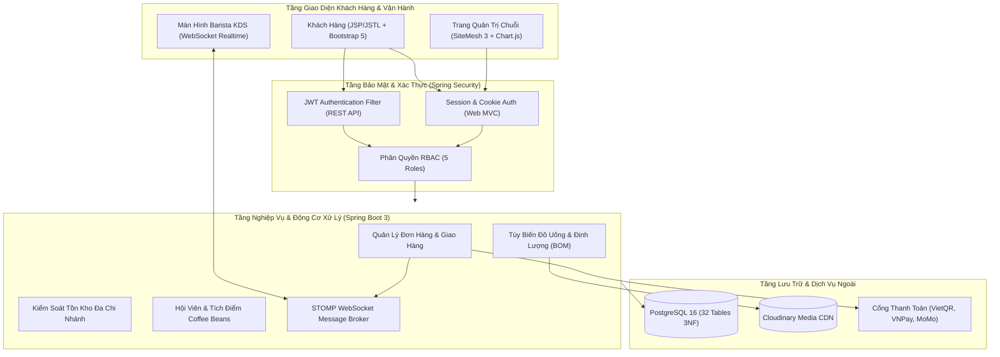
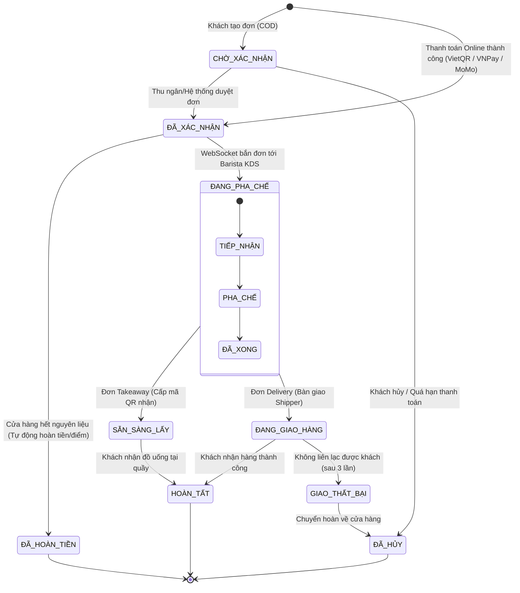

<p align="center">
  <picture>
    <source media="(prefers-color-scheme: dark)" srcset="03_Thiet_Ke_Thuong_Hieu_Logo/logo_chinh_ngang_dark.png">
    <source media="(prefers-color-scheme: light)" srcset="03_Thiet_Ke_Thuong_Hieu_Logo/logo_chinh_ngang_light.png">
    
  </picture>
</p>

<p align="center">
  <strong>Hệ Thống Website Thương Mại Điện Tử Chuỗi Bán Trà & Cà Phê Đặc Sản UTECoffe</strong><br>
  <em>Nền tảng thương mại đa kênh OMO (Online-Merge-Offline) • Quầy Barista thời gian thực KDS • Quản trị chuỗi cửa hàng F&B</em>
</p>

<p align="center">
  <a href="#-công-nghệ-sử-dụng"></a>
  <a href="#-công-nghệ-sử-dụng"></a>
  <a href="#-công-nghệ-sử-dụng"></a>
  <a href="#-công-nghệ-sử-dụng"></a>
  <a href="#-công-nghệ-sử-dụng"></a>
  <a href="#-công-nghệ-sử-dụng"></a>
  <a href="#-công-nghệ-sử-dụng"></a>
  <a href="#-công-nghệ-sử-dụng"></a>
</p>

<p align="center">
  <a href="#-giới-thiệu-đề-tài">Giới Thiệu</a> •
  <a href="#-nghiệp-vụ-cốt-lõi">Nghiệp Vụ F&B</a> •
  <a href="#-kiến-trúc-hệ-thống">Kiến Trúc</a> •
  <a href="#-cơ-sở-dữ-liệu">CSDL 32 Bảng</a> •
  <a href="#-tài-liệu-báo-cáo-word">Hồ Sơ Báo Cáo</a> •
  <a href="#-hướng-dẫn-cài-đặt">Cài Đặt</a> •
  <a href="#-tác-giả--bản-quyền">Tác Giả</a>
</p>

---

## 📌 Giới Thiệu Đề Tài

**UTECOFFE** là đồ án xây dựng hệ thống website thương mại điện tử chuyên biệt phục vụ chuỗi cửa hàng bán lẻ trà và cà phê đặc sản, tích hợp mô hình OMO (*Online-Merge-Offline / Bán hàng đa kênh*). Dự án giải quyết trọn vẹn bài toán vận hành thực tế ngành dịch vụ ăn uống (F&B):
- **Đối với Khách hàng:** Đặt món giao tận nơi (*Delivery*) hoặc lấy tại quán (*Takeaway Pickup*), tùy biến kích cỡ/đường/đá/topping, đặt bàn trước trực tuyến, thanh toán đa kênh (VietQR, VNPay, MoMo, COD) và tích lũy điểm hội viên.
- **Đối với Quầy pha chế (Barista):** Màn hình KDS (*Kitchen Display System*) nhận đơn thời gian thực qua WebSocket STOMP, cập nhật tiến độ pha chế 1-chạm phản hồi tức thì về ứng dụng của khách hàng.
- **Đối với Quản lý & Ban điều hành:** Quản lý tồn kho theo từng chi nhánh, định lượng công thức nguyên liệu (BOM), báo cáo doanh thu trực quan bằng Chart.js và phân quyền dữ liệu nghiêm ngặt theo 5 vai trò.

- **Đơn vị đào tạo:** Trường Đại học Sư phạm Kỹ thuật TP.HCM (HCMUTE)
- **Học phần:** Đồ án Lập trình Web / Hệ thống Thương mại Điện tử

---

## 🏛 Kiến Trúc Hệ Thống (Architecture Flow)



---

## 🎯 10 Khối Nghiệp Vụ F&B Cốt Lõi

| Khối Nghiệp Vụ | Mô Tả Chức Năng Chi Tiết |
| :--- | :--- |
| **1. Tùy Biến Đồ Uống (BOM Recipe)** | Hỗ trợ Size S/M/L, chọn % đường (0%, 30%, 50%, 70%, 100%, đường ăn kiêng), chọn mức đá (Nóng, 0%, 30%, 50%, 70%, 100%, Đá riêng), topping đa dạng (Trân châu, kem cheese, pudding). Với cà phê hạt: chọn mức độ rang (Light/Medium/Dark) và cỡ xay (Nguyên hạt, pha phin, pha máy Espresso, Cold Brew). Gợi ý bánh ngọt ăn kèm (Cross-sell). |
| **2. Bán Hàng Đa Kênh (Omnichannel)** | **Giao tận nơi (Delivery):** Tự động xác định chi nhánh gần nhất theo tọa độ địa lý, tính phí vận chuyển theo khoảng cách thực tế (km).<br>**Lấy tại quán (Takeaway Pickup):** Khách chọn chi nhánh, đặt giờ hẹn nhận món và nhận mã QR nhận hàng tại quầy. |
| **3. Tồn Kho Đa Chi Nhánh (Store Stock)** | Kiểm soát tồn kho nguyên liệu độc lập tại từng cơ sở. Tự động chuyển trạng thái "Tạm hết món" tại chi nhánh thiếu nguyên liệu mà không làm ảnh hưởng tới việc kinh doanh của các chi nhánh khác. |
| **4. Quầy Pha Chế KDS Thời Gian Thực** | Đẩy đơn hàng mới tức thì qua WebSocket STOMP kèm âm thanh chuông báo tới màn hình Barista của chi nhánh. Xếp hàng pha chế theo cơ chế FIFO (First-In, First-Out), cảnh báo đổi màu theo thời gian chờ. Barista đổi trạng thái 1-chạm (*Tiếp nhận -> Đang pha -> Pha xong*). |
| **5. Cập Nhật Tiến Trình Realtime** | Khi Barista hoàn thành pha chế, WebSocket tự động đẩy dữ liệu cập nhật trạng thái đơn hàng trên thanh tiến trình (Tracking Stepper) của khách hàng mà không cần tải lại trang. |
| **6. Hội Viên & Điểm Thưởng (Loyalty)** | Tích lũy điểm thưởng: **10.000 VNĐ = 1 Coffee Bean**. Tự động xếp 4 hạng: **Đồng (Bronze) -> Bạc (Silver) -> Vàng (Gold - Giảm 5%) -> Kim Cương (Diamond - Giảm 10%)**. Ví voucher cá nhân, đổi điểm lấy mã giảm giá hoặc topping miễn phí. |
| **7. Khuyến Mãi Đa Tầng (Promotion Engine)** | Mã giảm giá Coupon, khung giờ vàng Happy Hour, mua 1 tặng 1 (BOGO), combo tiết kiệm (Trà + Bánh). Cơ chế kiểm tra điều kiện áp dụng và giới hạn lượt dùng chống lạm dụng mã. |
| **8. Thanh Toán Đa Kênh & Hoàn Tiền** | Tiền mặt khi nhận hàng (COD), VNPay, MoMo, ZaloPay. **VietQR động:** Tạo mã QR chuyển khoản chứa mã đơn và số tiền chính xác, tự động đối soát giao dịch. Tự động hoàn tiền/hoàn điểm khi hủy đơn do sự cố. |
| **9. Đặt Bàn Trực Tuyến (Table Reservation)** | Chọn chi nhánh, ngày giờ, số lượng khách và khu vực bàn (*Máy lạnh trong nhà, Ban công ngắm phố, Sân vườn, Phòng họp nhóm*). Hỗ trợ gọi trước đồ uống kèm theo bàn để rút ngắn thời gian phục vụ. |
| **10. Báo Cáo Kinh Doanh & Phân Quyền** | Báo cáo doanh thu theo ngày/tháng/năm, so sánh doanh thu giữa các chi nhánh, thống kê Top 10 đồ uống bán chạy nhất qua biểu đồ Chart.js. Phân quyền chặt chẽ 5 vai trò (*Admin, Store Manager, Barista, Shipper, Customer*) và Audit Log ghi vết thao tác. |

---

## 🔄 Luồng Vận Hành Đơn Hàng (Order State Machine)



---

## 🏛 Cơ Sở Dữ Liệu (32 Bảng Chuẩn 3NF)

<details>
<summary><strong>👉 Nhấn để xem chi tiết 6 phân hệ và 32 bảng cơ sở dữ liệu</strong></summary>

```
[1. Người Dùng & Phân Quyền]
  ├── users (Tài khoản, họ tên, email, số điện thoại, mật khẩu mã hóa BCrypt, hạng thành viên)
  ├── roles (Danh mục 5 vai trò: ROLE_ADMIN, ROLE_STORE_MANAGER, ROLE_BARISTA, ROLE_SHIPPER, ROLE_CUSTOMER)
  ├── user_roles (Bảng liên kết n-n giữa người dùng và vai trò)
  └── user_addresses (Sổ địa chỉ nhận hàng, kinh độ/vĩ độ giao hàng)

[2. Chuỗi Cửa Hàng & Quản Trị Kho]
  ├── stores (Thông tin chi nhánh: tên, địa chỉ, hotline, giờ mở/đóng cửa, tọa độ Lat/Long)
  ├── store_tables (Danh sách bàn tại quán, sức chứa, phân khu máy lạnh/sân vườn/ban công)
  ├── ingredients (Danh mục nguyên liệu thô: hạt cà phê Arabica/Robusta, trà khô, sữa, siro, đào ngâm)
  ├── store_inventory (Số lượng tồn kho của từng nguyên liệu tại từng chi nhánh cụ thể)
  └── inventory_logs (Nhật ký xuất nhập kho, cân đối hao hụt nguyên liệu định kỳ)

[3. Danh Mục Sản Phẩm & Định Lượng BOM]
  ├── categories (Danh mục: Cà phê truyền thống, Cà phê pha máy, Trà trái cây, Trà sữa, Bánh ngọt)
  ├── products (Sản phẩm đồ uống, mô tả, ảnh đại diện Cloudinary, trạng thái kinh doanh)
  ├── product_sizes (Các size S, M, L và chênh lệch giá tương ứng)
  ├── toppings (Danh mục các loại topping gọi thêm và đơn giá)
  ├── product_toppings (Quy định loại topping được phép gọi kèm cho từng sản phẩm)
  └── recipes (Công thức định lượng chi tiết nguyên liệu tiêu hao cho từng ly đồ uống)

[4. Đơn Hàng & Vận Hành Pha Chế]
  ├── orders (Mã đơn hàng, chi nhánh phục vụ, loại đơn Delivery/Pickup, trạng thái, tổng tiền)
  ├── order_items (Chi tiết từng món: size, % đường, % đá, ghi chú pha chế của khách)
  ├── order_item_toppings (Danh sách topping đi kèm từng ly)
  ├── order_trackings (Lịch sử mốc thời gian chuyển trạng thái đơn hàng phục vụ Stepper realtime)
  └── table_reservations (Phiếu đặt bàn trước: chi nhánh, ngày giờ đến, số khách, khu vực)

[5. Khuyến Mãi & Chương Trình Hội Viên]
  ├── loyalty_cards (Thẻ tích điểm hội viên, số dư điểm Bean hiện tại, tổng chi tiêu tích lũy)
  ├── loyalty_transactions (Lịch sử cộng điểm từ đơn hàng hoặc trừ điểm khi đổi voucher)
  ├── coupons (Mã giảm giá, chương trình khuyến mãi, Happy Hour, Mua 1 tặng 1)
  └── user_coupons (Ví voucher riêng của từng khách hàng)

[6. Thanh Toán & Giám Sát Hệ Thống]
  ├── payments (Giao dịch thanh toán: mã tham chiếu cổng, phương thức COD/VNPay/MoMo/VietQR)
  ├── refunds (Lịch sử hoàn tiền khi hủy đơn hàng, lý do hoàn tiền)
  ├── reviews (Đánh giá chất lượng 1-5 sao, nhận xét chữ, ảnh chụp đồ uống thực tế)
  └── audit_logs (Nhật ký kiểm toán: ghi nhận người thực hiện, thao tác, IP truy cập, thời điểm)
```
</details>

---

## 📁 Hồ Sơ Báo Cáo Đồ Án (Thư Mục `01_Tai_Lieu_Bao_Cao_Word`)

Hệ thống tài liệu đồ án được biên soạn đầy đủ, khoa học bằng định dạng Microsoft Word (.docx), sẵn sàng phục vụ công tác báo cáo và đánh giá:

| Tệp Báo Cáo | Tên Tài Liệu & Nội Dung Trọng Tâm |
| :---: | :--- |
| **00** | [00_Bao_Cao_Tong_Hop_Toan_Bo_Do_An_UTECOFFE.docx](01_Tai_Lieu_Bao_Cao_Word/00_Bao_Cao_Tong_Hop_Toan_Bo_Do_An_UTECOFFE.docx)<br><em>Báo cáo tổng hợp toàn bộ đề tài (1.300+ đoạn văn, 106 bảng dữ liệu, trang bìa và biểu tượng chính thức).</em> |
| **01** | [01_Khao_Sat_Thuc_Te_Cac_Chuoi_FNB.docx](01_Tai_Lieu_Bao_Cao_Word/01_Khao_Sat_Thuc_Te_Cac_Chuoi_FNB.docx)<br><em>Khảo sát thực trạng quy trình vận hành của các chuỗi F&B lớn (Highlands, Phúc Long, The Coffee House, % Arabica).</em> |
| **02** | [02_Phan_Tich_Nghiep_Vu_Va_65_Quy_Tac_BR.docx](01_Tai_Lieu_Bao_Cao_Word/02_Phan_Tich_Nghiep_Vu_Va_65_Quy_Tac_BR.docx)<br><em>Từ điển nghiệp vụ, phạm vi P0/P1/P2 và đặc tả 65 quy tắc kinh doanh bắt buộc (BR-01 đến BR-65).</em> |
| **03** | [03_Thiet_Ke_Kien_Truc_CSDL_32_Bang_Va_API.docx](01_Tai_Lieu_Bao_Cao_Word/03_Thiet_Ke_Kien_Truc_CSDL_32_Bang_Va_API.docx)<br><em>Thiết kế cơ sở dữ liệu 32 bảng quan hệ chuẩn 3NF, cấu hình Spring Data JPA và danh mục RESTful API.</em> |
| **04** | [04_Ke_Hoach_WBS_33_Goi_Va_Tien_Do_24_Tuan.docx](01_Tai_Lieu_Bao_Cao_Word/04_Ke_Hoach_WBS_33_Goi_Va_Tien_Do_24_Tuan.docx)<br><em>Cấu trúc phân rã công việc (33 gói WBS), phân bổ Sprint và biểu đồ tiến độ triển khai chi tiết 24 tuần.</em> |
| **05** | [05_Ke_Hoach_Kiem_Thu_Chat_Luong_191_TC.docx](01_Tai_Lieu_Bao_Cao_Word/05_Ke_Hoach_Kiem_Thu_Chat_Luong_191_TC.docx)<br><em>Kế hoạch kiểm thử nghiệm thu toàn diện với 191 Test Cases (Kiểm thử chức năng, tải, an ninh và kịch bản biên).</em> |
| **06** | [06_Nhat_Ky_Ra_Soat_Va_Quan_Ly_Quyet_Dinh.docx](01_Tai_Lieu_Bao_Cao_Word/06_Nhat_Ky_Ra_Soat_Va_Quan_Ly_Quyet_Dinh.docx)<br><em>Nhật ký kiểm soát thay đổi, quản trị rủi ro và các quyết định kiến trúc công nghệ (ADR).</em> |
| **07** | [07_Doi_Chieu_12_Tieu_Chi_De_Bai_Va_Cong_Nghe.docx](01_Tai_Lieu_Bao_Cao_Word/07_Doi_Chieu_12_Tieu_Chi_De_Bai_Va_Cong_Nghe.docx)<br><em>Ma trận đối chiếu đáp ứng 12 tiêu chí công nghệ đề bài yêu cầu (Spring Boot, JSP, Sitemesh, JPA, JWT, WebSocket...).</em> |
| **08** | [08_Dac_Ta_Chi_Tiet_41_Luong_Nghiep_Vu_UC.docx](01_Tai_Lieu_Bao_Cao_Word/08_Dac_Ta_Chi_Tiet_41_Luong_Nghiep_Vu_UC.docx)<br><em>Đặc tả chi tiết 41 luồng ca sử dụng (Use Cases UC-01 đến UC-41) gồm luồng chính, luồng phụ và xử lý ngoại lệ.</em> |
| **09** | [09_Hop_Dong_Du_Lieu_Lenh_Va_Van_Hanh_He_Thong.docx](01_Tai_Lieu_Bao_Cao_Word/09_Hop_Dong_Du_Lieu_Lenh_Va_Van_Hanh_He_Thong.docx)<br><em>Đặc tả cấu trúc sự kiện Payload, WebSocket STOMP Topics, cấu trúc Token JWT và cam kết chất lượng dịch vụ (SLA).</em> |
| **10** | [10_Ma_Tran_Truy_Vet_158_Chuc_Nang_F.docx](01_Tai_Lieu_Bao_Cao_Word/10_Ma_Tran_Truy_Vet_158_Chuc_Nang_F.docx)<br><em>Ma trận truy vết 158 yêu cầu chức năng (F-001 đến F-158) nối kết hai chiều giữa BR, Use Case và Test Case.</em> |
| **11** | [11_Quy_Chuan_Logo_Va_Nhan_Dien_Thuong_Hieu.docx](01_Tai_Lieu_Bao_Cao_Word/11_Quy_Chuan_Logo_Va_Nhan_Dien_Thuong_Hieu.docx)<br><em>Bản thuyết minh ý nghĩa biểu tượng The Golden Drop, tâm lý màu sắc, quy tắc Typography và khoảng cách an toàn.</em> |
| **12** | [12_Bao_Cao_Giai_Phap_Nghiep_Vu_FNB_Thuc_Te.docx](01_Tai_Lieu_Bao_Cao_Word/12_Bao_Cao_Giai_Phap_Nghiep_Vu_FNB_Thuc_Te.docx)<br><em>Báo cáo chuyên sâu giải quyết 6 nhóm kịch bản biên thực tế (POS Offline, KDS Barista, tồn kho đa chi nhánh, ca làm việc).</em> |

---

## 🎨 Bộ Nhận Diện Thương Hiệu (Brand Identity System)

Hệ thống biểu tượng **UTECOFFE** được thiết kế theo phong cách tối giản hiện đại (*Contemporary Minimalist*), nền trong suốt (*Transparent Background*) và tương thích với cả giao diện tối (*Dark Theme*) lẫn giao diện sáng (*Light Theme*):

<p align="center">
  
  &nbsp;
  
</p>

### Ý Nghĩa Biểu Tượng (The Golden Drop & Camellia Leaf):
- **Giọt tinh hoa chiết xuất (The Essence Drop):** Tượng trưng cho sự chắt lọc tinh túy qua bàn tay nghệ nhân pha chế (Barista Craft) từ nông trại đến tách đồ uống.
- **Búp trà non Camellia Sinensis (Mạn trái - Vàng Champagne `#C5A463`):** Đại diện cho hương vị thanh thuần, nguồn nguyên liệu tự nhiên của những đồi chè Tây Nguyên/Bảo Lộc.
- **Hạt cà phê Arabica rang mộc (Mạn phải - Đen khói Obsidian `#181615`):** Biểu trưng cho sự đậm đà, chiều sâu, tính kiên định và phong cách thưởng thức cà phê nguyên bản.
- **Điểm giao thoa tâm điểm (Diamond Core):** Điểm nhấn hình thoi biểu trưng cho "Tỷ lệ vàng" trong công thức chiết xuất, đồng thời ẩn dụ ngòi bút tri thức kỹ thuật từ mái trường UTE.
- **Dáng chữ "U" âm bản:** Khéo léo tạo hình chữ U đại diện cho thương hiệu UTECoffe.

---

## 🚀 Hướng Dẫn Cài Đặt & Chạy Thử (Getting Started)

### 1. Yêu Cầu Môi Trường (Prerequisites)
- **Java Development Kit (JDK):** Version 17 hoặc 21 (Eclipse Temurin / Oracle OpenJDK).
- **Cơ sở dữ liệu:** PostgreSQL 15+ (hoặc MySQL 8.0+).
- **Build Tool:** Apache Maven 3.8+ (hoặc sử dụng wrapper `mvnw` đi kèm).
- **Trình duyệt khuyến nghị:** Google Chrome, Microsoft Edge, Mozilla Firefox phiên bản mới nhất.

### 2. Clone Mã Nguồn
```bash
git clone https://github.com/JiaysTM17/UTECOFFE.git
cd UTECoffe
```

### 3. Cấu Hình Biến Môi Trường (`application.properties`)
Cấu hình kết nối cơ sở dữ liệu và các dịch vụ tích hợp tại `src/main/resources/application.properties`:
```properties
# Server Configuration
server.port=8080
server.servlet.context-path=/

# Database Configuration (PostgreSQL)
spring.datasource.url=jdbc:postgresql://localhost:5432/utecoffe_db
spring.datasource.username=postgres
spring.datasource.password=your_secure_password
spring.jpa.hibernate.ddl-auto=update
spring.jpa.show-sql=true
spring.jpa.properties.hibernate.dialect=org.hibernate.dialect.PostgreSQLDialect

# Cloudinary Storage Configuration
cloudinary.cloud-name=your_cloud_name
cloudinary.api-key=your_api_key
cloudinary.api-secret=your_api_secret

# JWT Secret & Expiration
jwt.secret=9a8b7c6d5e4f3a2b1c0d9e8f7a6b5c4d3e2f1a0b9c8d7e6f5a4b3c2d1e0f
jwt.expiration-ms=86400000

# VNPay Sandbox Configuration
vnpay.tmn-code=your_tmn_code
vnpay.hash-secret=your_hash_secret
vnpay.pay-url=https://sandbox.vnpayment.vn/paymentv2/vpcpay.html
```

### 4. Khởi Chạy Ứng Dụng
```bash
# Trên Linux/macOS
./mvnw clean spring-boot:run

# Trên Windows PowerShell / Command Prompt
.\mvnw.cmd clean spring-boot:run
```

Sau khi ứng dụng khởi chạy thành công, truy cập các cổng chức năng:
- **Cổng Khách Hàng (Web Store):** `http://localhost:8080/`
- **Màn Hình Barista KDS:** `http://localhost:8080/barista/orders`
- **Trang Quản Trị Hệ Thống (Admin):** `http://localhost:8080/admin/dashboard`

---

## 👥 Tác Giả & Bản Quyền

- **Sinh viên thực hiện:** Trương Gia Kiệt ([@JiaysTM17](https://github.com/JiaysTM17))
- **Email:** `truonggiakiet110806@gmail.com`
- **Đơn vị:** Khoa Công nghệ Thông tin - Trường Đại học Sư phạm Kỹ thuật TP.HCM (HCMUTE)
- **Giấy phép:** Phục vụ mục đích học tập, nghiên cứu khoa học và phát triển phần mềm đồ án.

---

<p align="center">
  <em>Đồ án phát triển phần mềm phục vụ học phần Lập trình Web & Thương mại điện tử • Năm học 2026</em>
</p>
